# Partner Portal prototype

A clickable, single-page prototype of a partner portal for a managed security services provider (MSSP).
Partners register deals, find sales material and track commission. The vendor approves each deal,
application, tier change and payout in three steps.
**All companies, people and figures are fictional sample data. "Northwind Security" is a fictional company.**

| Sign-in with demo accounts | Partner dashboard |
|---|---|
| 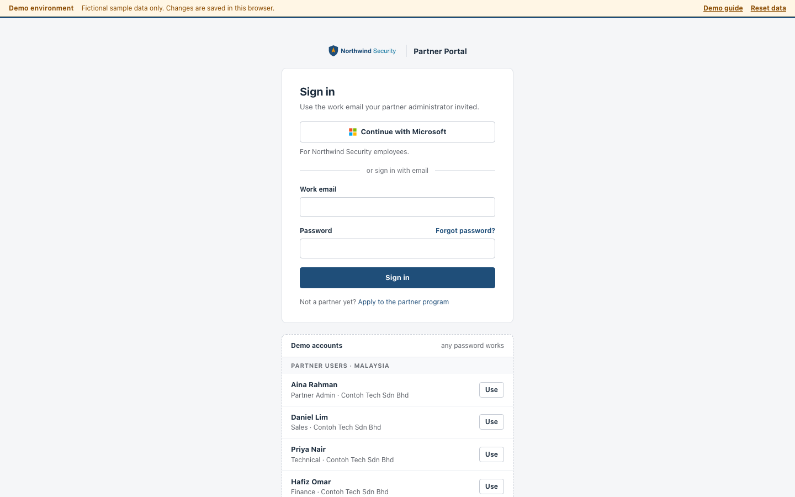 | 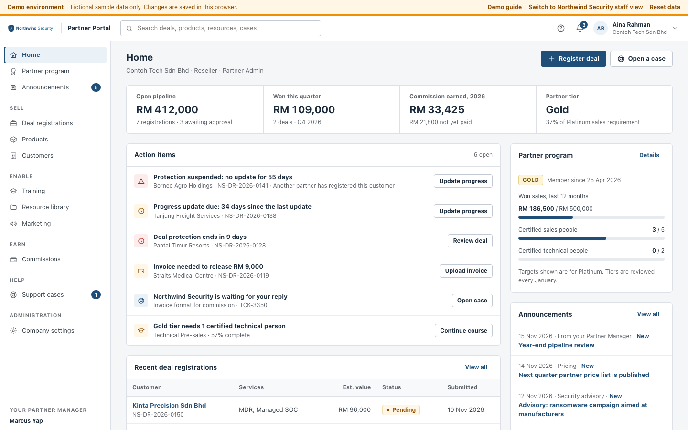 |
| **Three-step deal approval (vendor view)** | **Commissions** |
|  | 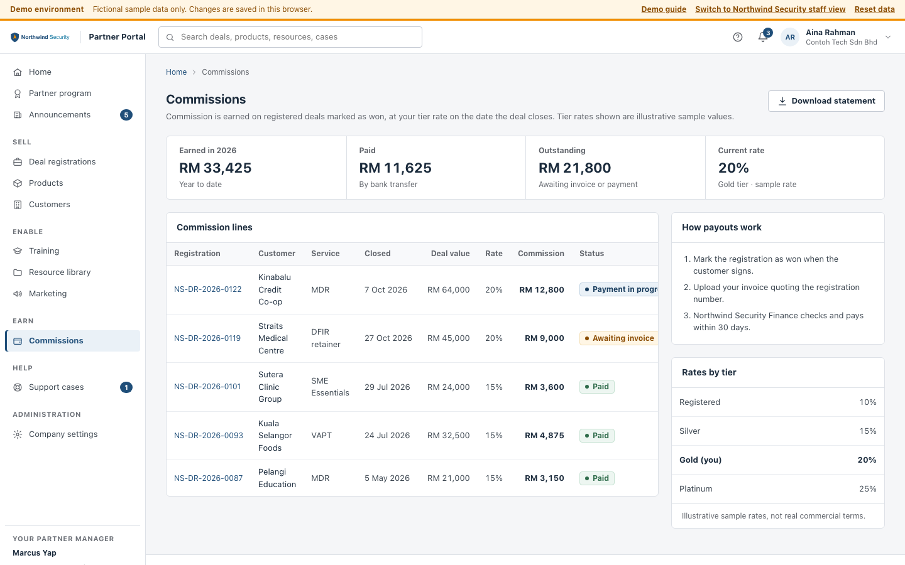 |

## What it does

The portal has two sides that share one data set:

- **Partner side** (resellers, MSPs, referral partners and distributors): apply to join, register
  opportunities, follow approvals, download sales material, take training, raise support cases and
  track commission. Partner roles are Partner Admin, Sales, Technical and Finance, and each role sees
  only its own menu items (for example, Sales cannot see commissions).
- **Vendor side** (the MSSP's own staff): Partner Managers who each cover one or more territories,
  a step-2 approver, a final approver, Marketing, Finance and a Portal Admin. Staff only see partners
  and deals in their own territories.

Everything runs in the browser. There is no server: the sample data is created on first load and
saved in the browser's `localStorage`, so changes survive a page refresh until you click **Reset data**.
All dates are relative to today, so the demo always looks current.

## The three-step approval flow

Deal registrations, partner applications, tier changes and commission payouts all go through the same
three steps:

1. **Owner review**: the partner's own Partner Manager checks the item (for a deal: verification
   checks, evidence and possible conflicts) and approves, asks for more information, or rejects.
2. **Second approval**: a step-2 approver approves, sends back or rejects.
3. **Final approval**: the final approver signs off. Only then is a deal protected, an applicant
   given a partner account, a tier changed or a payout released.

Every step is time-stamped in the item's history and in the audit log. An item waiting 2 working
days at one step shows "Reminder sent", and after 4 working days it is marked overdue.

### Rules built into the demo

- **Deal checks**: company identified (registration number and website), a business email address
  (personal addresses such as free-mail domains are blocked) and proof of budget (letter of intent,
  purchase order or tender) are required. A recent meeting, proof of engagement and customer
  confirmation by email are optional extras.
- **Duplicate detection**: registering a customer that another partner already registered raises a
  conflict for the vendor to resolve; the first valid, active registration normally wins.
- **Protection**: 90 days from approval, plus one 30-day extension on request. A deal with no progress
  update for 30 days shows "Update due"; after 50 days it becomes "Inactive", protection is suspended
  and the customer can be given to another partner (again through three approvals).
- **Commission**: deal value x the partner's tier rate when the deal is marked as won. The tier rates
  in the demo (Registered 10%, Silver 15%, Gold 20%, Platinum 25%) are **illustrative sample values,
  not real commercial terms**. Commission moves from "Awaiting invoice" to "Invoice submitted" to
  "Ready for payment" to "Paid".
- **Currencies**: each territory trades in its own currency (MYR, SGD, LKR, USD); staff also see a
  ringgit equivalent using sample exchange rates.

## Features

**Partner side**
- Application form with territory-based Partner Manager choice and a consent check
- Sign-in with simulated two-step verification
- Dashboard with pipeline, won sales, commission and tier progress, plus an action list
  (updates due, protection ending, invoices needed)
- Deal registration form in three pages (customer, opportunity, review and submit) with
  verification checks, a duplicate warning and a preview of the confirmation email sent to the
  customer contact
- Deal pages with approval tracker, protection timer, progress updates, documents and history
- Product catalogue with positioning notes, local prices and margin per tier
- Resource library gated by tier, marketing campaigns and a co-branding kit
- Training courses and certificates; partner program page with tier requirements and benefits
- Customers page with sample service reports, support cases, announcements and notifications
- Company settings: users and roles, invitations restricted to the company's own email domain,
  sessions and a security log

**Vendor side**
- "My approvals" queue for each approver, with territory filtering
- Conflict resolution between partners, extension requests and tier change requests
- Partner applications, invitations and partner management
- Payout approvals and payment recording for Finance
- Content publishing for Marketing (resources and announcements)
- Staff handover when someone leaves (partners and approval steps are reassigned)
- Audit log of every sign-in, change and administrative action
- A "Viewing as" switcher in the demo strip to act as any staff member

## How to run it

1. Open `index.html` in a recent browser (Chrome, Edge, Firefox or Safari). No server or install is needed.
2. On the sign-in page, click **Use** next to any demo account. Any password and any 6-digit code work.
3. Open **Demo guide** in the yellow strip for a short walkthrough: register a deal as a partner,
   switch to the vendor view, and approve it through all three steps.
4. Click **Reset data** in the strip at any time to return to the original sample data.

## How to rebuild it

The page is built from the files in `src/`:

```
partner-portal-demo/
  index.html        built single-file demo (open this)
  build.py          packs src/ into index.html
  src/
    app.js          all screens, rules and actions (plain JavaScript, no framework)
    seed.js         the fictional sample data
    style.css       styles
    logo.svg        the fictional wordmark
  diagrams/         Mermaid sources of the diagrams below
  images/           screenshots
```

Edit the files in `src/`, then run (Python 3, no packages needed):

```
python3 build.py
```

`build.py` inlines `seed.js` and the logo into `app.js`, and writes one self-contained `index.html`.
To syntax-check the combined script as well, run `python3 build.py check.js && node --check check.js`.

## Architecture

The prototype is a single page, but it was designed against a proposed production architecture,
which is **not built**. The diagrams below describe that design. Their sources are in `diagrams/`.

### Use cases: partner side

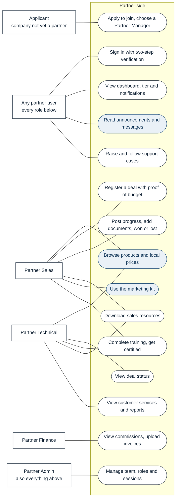

### Use cases: vendor side

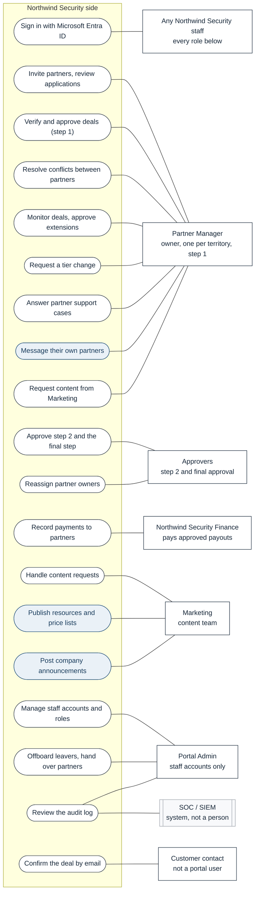

### Hand-offs: partner actions that create a task for the vendor

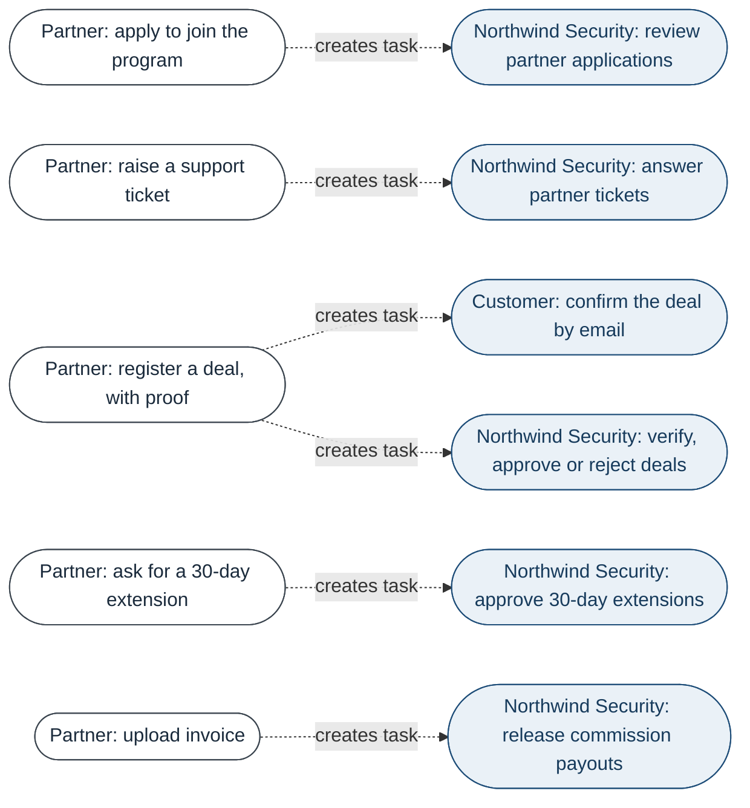

### Hand-offs: what the vendor publishes for partners

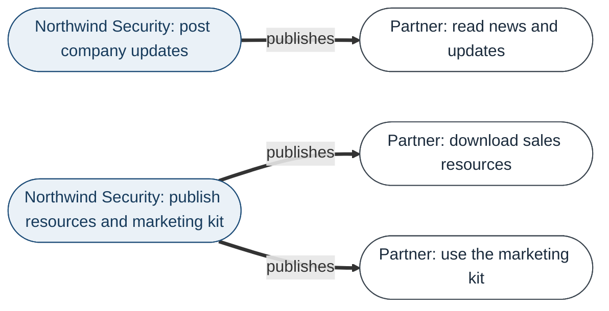

### System architecture (proposed)

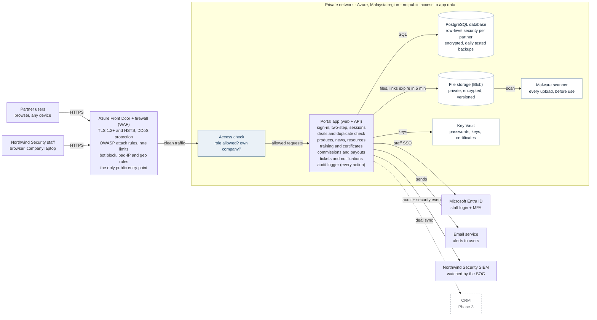

### Security checks on every request

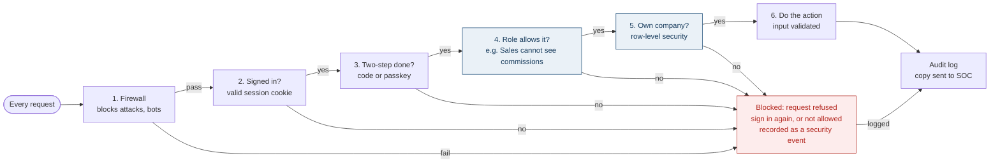

### Deal registration, step by step

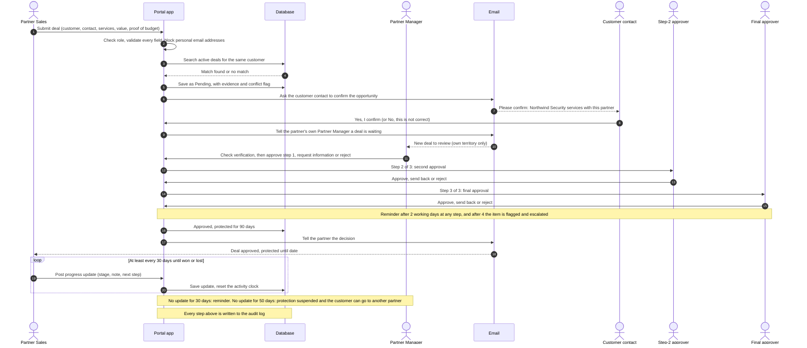

### Deal stages

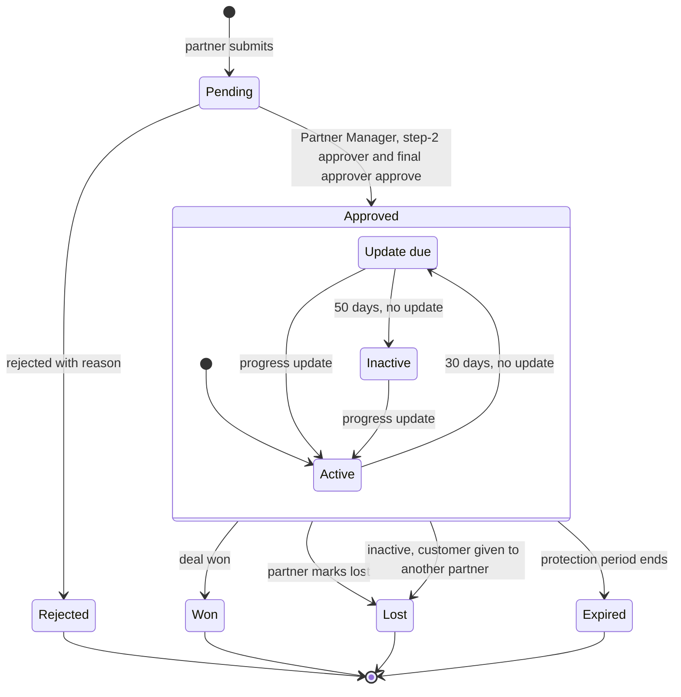

### Commission stages

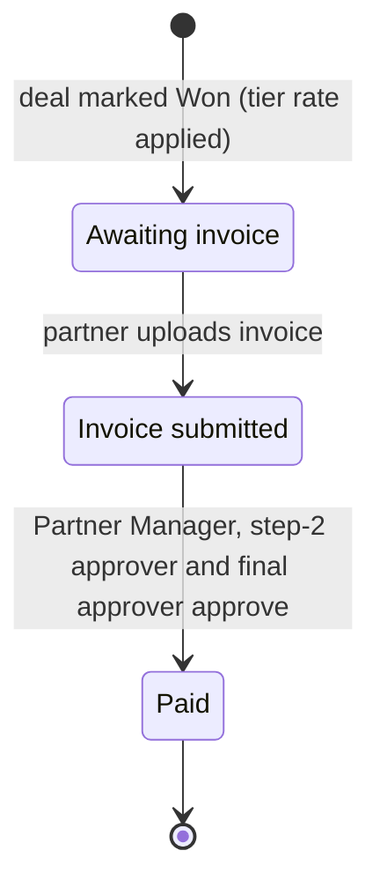

### How sign-in works

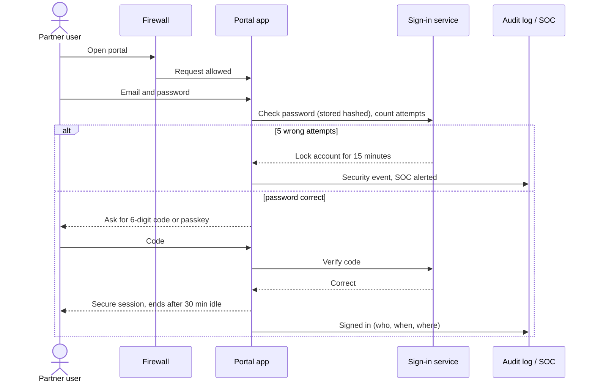

### Data model

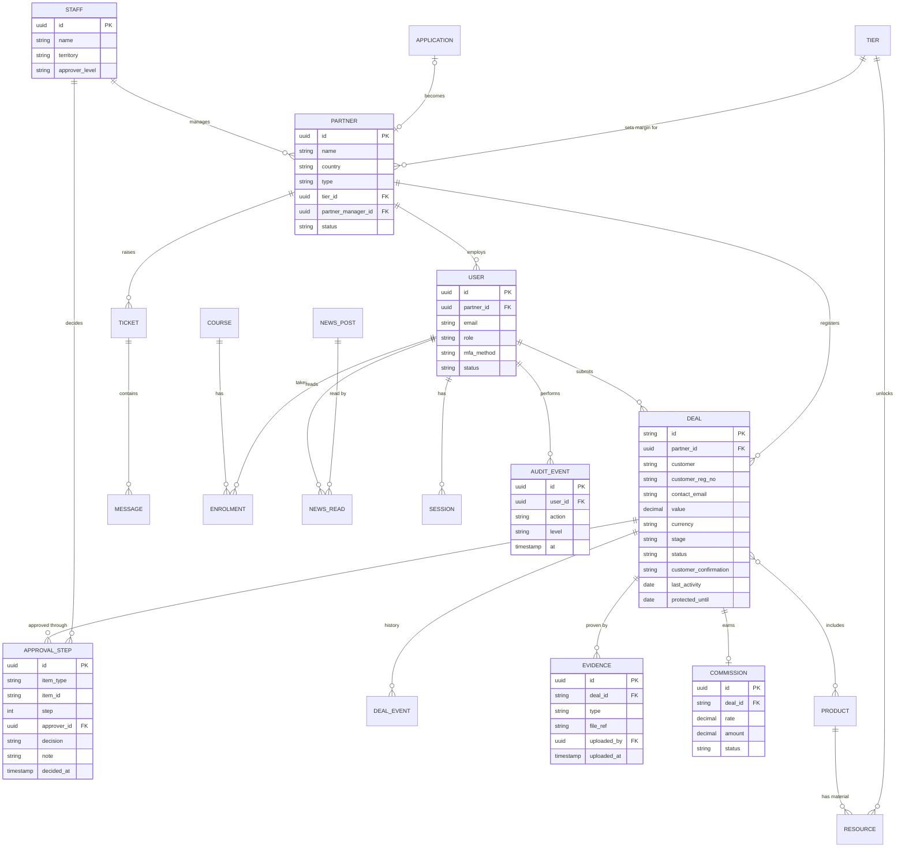

### Build phases (proposed)

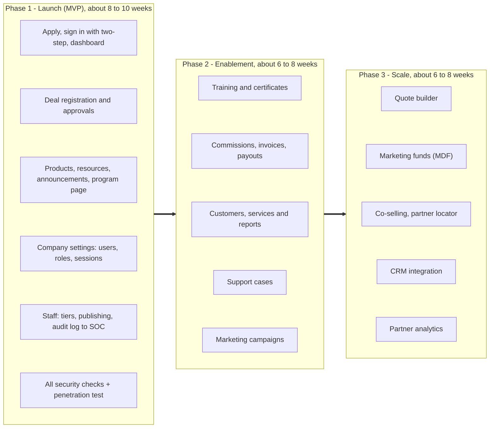

## Limitations

This is a prototype for walking through the workflow, not a working system:

- No backend, database or real authentication. Any password works and sign-in is simulated.
- File uploads, emails, malware scanning and the SOC integration are shown but not performed.
- Data lives only in the visitor's own browser.

## About the data

All data in this project is fictional sample data: "Northwind Security", the partner companies,
customers, people, email addresses (`.example` domains and `example.com`), registration numbers,
phone numbers, prices, deal values, targets and commission rates. Any resemblance to real
organisations or people is coincidental.
