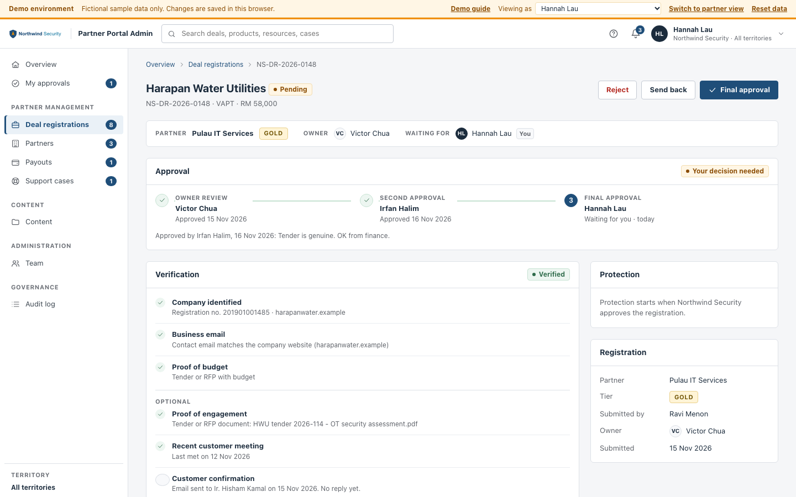

# Partner Enablement Portal Demo

A clickable, single-page prototype of a partner portal for a managed security services provider (MSSP). Partners
register deals, find sales material and track commission; the vendor approves each deal, application, tier change
and payout in three steps. **All companies, people and figures are fictional sample data. "Northwind Security" is a
fictional company.**

**[Open the live demo](https://ainunizhar.github.io/Partner-Enablement-Portal-Demo/)**

| Partner dashboard | Three-step deal approval (vendor view) |
|---|---|
|  |  |

## What's inside
- **Partner side:** apply to join, register deals (a three-page form with verification checks and a duplicate
  warning), follow approvals, download sales material, take training, raise support cases and track commission.
  Each partner role (Admin, Sales, Technical, Finance) sees only its own menu.
- **Vendor side:** approval queues by territory, conflicts between partners, payout approvals, content publishing,
  staff handover and an audit log of every action.
- **Three-step approval** for deals, applications, tier changes and payouts: owner review, second approval, final
  approval. Every step is time-stamped; a reminder shows after 2 working days and the item is overdue after 4.
- **Built-in rules:** proof of budget and a business email are required; deals are protected for 90 days (plus one
  30-day extension); "Update due" after 30 days without progress and "Inactive" after 50; commission = deal value ×
  tier rate (illustrative sample rates).
- **Proposed production design** (not built), as Mermaid diagrams in [`diagrams/`](diagrams/): use cases, system
  architecture, security checks, deal and commission stages, sign-in, data model and build phases.

## How it's built
- Plain JavaScript with no framework and no server: `src/app.js` (screens, rules, actions), `src/seed.js`
  (fictional data) and `src/style.css`.
- `build.py` packs `src/` into one self-contained `index.html`.
- Sample data is created on first load and kept in the browser's `localStorage`. All dates are relative to today,
  so the demo always looks current.

## Open it
- Use the live demo, or open `index.html` in any recent browser. Nothing to install.
- Click **Use** next to any demo account (any password and any 6-digit code work), then follow the **Demo guide** in
  the yellow strip. **Reset data** restores the sample data.
- After editing `src/`, rebuild with `python3 build.py`.
- It is a prototype: there is no backend or real sign-in, and uploads and emails are shown but not sent.

**Tools:** JavaScript, HTML, CSS, Python (build script), Mermaid · built with Claude Code as a coding assistant
